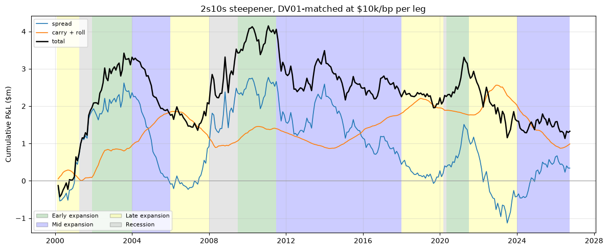

# Task 5: 2s10s steepener with carry and roll

## Position

Both legs are sized so that a 1bp move in their own yield produces the same $10,000. 

| Leg | Position | Modified duration | Notional | DV01 |
|---|---|---|---|---|
| 2-year | long | 1.85y | $54.2m | $10,000/bp |
| 10-year | short | 7.21y | $13.9m | $10,000/bp |

## Data

| Series | Use |
|---|---|
| `DGS2`, `DGS10` | the two legs, and the 2s10s spread |
| `DGS1`, `DGS7` | neighbouring points for the roll-down slope |
| `DFF` | financing, applied to both legs |
| `USREC` | NBER recession dating |

## P&L decomposition

| Component | Cumulative | Annualised % of capital | Monthly sd |
|---|---|---|---|
| spread | +$0.34m | +0.3% | $172k |
| carry and roll | +$0.99m | +0.7% | $37k |
| &nbsp;&nbsp;roll | +$1.85m | +1.4% | $23k |
| &nbsp;&nbsp;carry | -$0.86m | -0.6% | $18k |
| **total** | **+$1.33m** | **+1.0%** | **$169k** |

## Performance

| Metric | |
|---|---|
| Annualised return | 0.99% |
| Annualised volatility | 11.70% |
| Sharpe | 0.085 |
| Maximum drawdown | -32.96% |

Capital is a flat $5m. The position is self-funded and the P&L stream is an excess return. The
capital determines leverage and scales the return and volatility together; leaving Sharpe unchanged.
Drawdown is measured against the peak of $5m plus cumulative P&L, which peaks at $4.15m.

## Business cycle phases

| Phase | Spread | Carry and roll | Total | Months | $k per month |
|---|---|---|---|---|---|
| Early expansion | +1.56 | +1.06 | +2.62 | 63 | +41.6 |
| Mid expansion | -3.91 | +0.27 | -3.64 | 135 | -27.0 |
| Late expansion | -0.10 | -0.28 | -0.38 | 94 | -4.1 |
| Recession | +2.79 | -0.06 | +2.73 | 28 | +97.4 |
| Expansion, all three | -2.45 | +1.05 | -1.40 | 292 | -4.8 |

Cumulative figures in millions of dollars.

The steepener made money in recessions and early expansions. Recessions are by far the strongest
period at $97.4k per month, effectively all of it from the spread, with carry and roll insignifcantly
negative. Early expansion is the only other profitable phase, at $41.6k per month, and the only
phase in which the spread and the carry and roll components are both positive.

The flattener made money through mid expansion, where the steepener loses $27.0k per month across
135 months, the longest and weakest stretch in the sample. Late expansion is close to flat.
