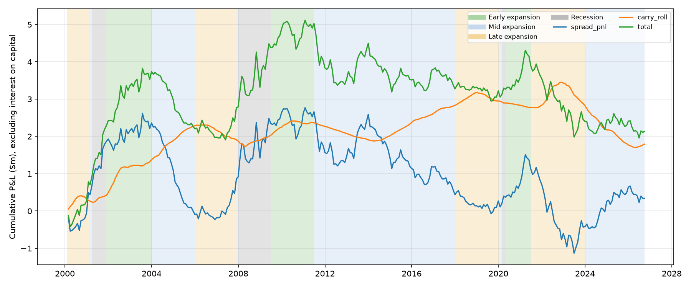

# Task 5

CAGR 3.36%, volatility 6.38%, Sharpe 0.24, max drawdown -16.47%. Bond P&L: $2.13m, mainly carry and roll. The steepener gained during recession/recovery; the flattener benefited from flattening in 2004-2006 and 2021-2022.

$5m capital earning T-bill interest; DV01 $10,000/bp per leg. Sample: February 2000 - September 2026. Returns include interest on capital. Transaction costs are zero; duration, roll and expansion-phase labels are approximations.

